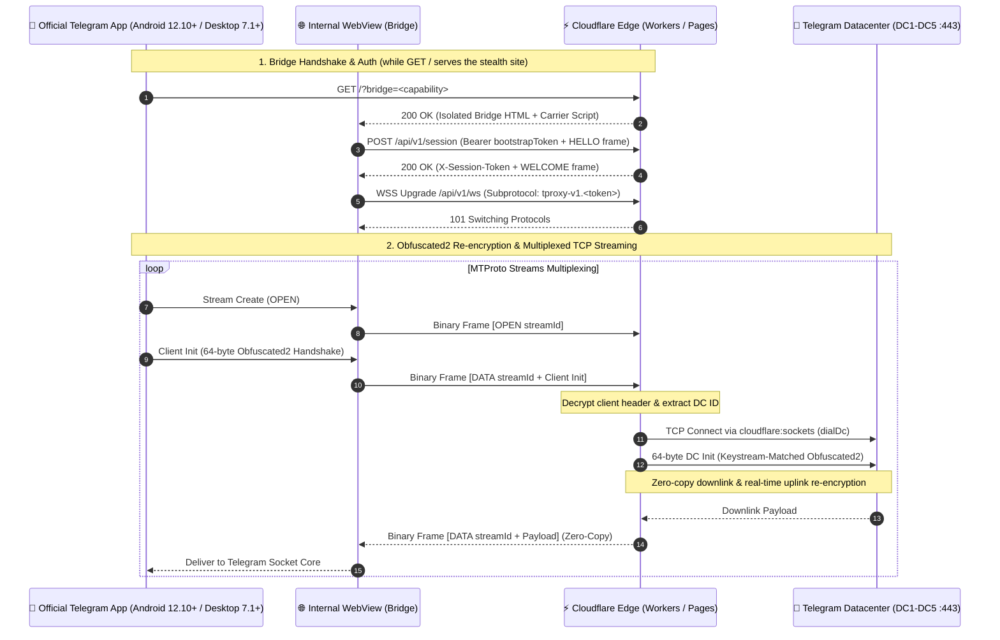

<div align="center">


# ⚡ TWP (Telegram Worker Proxy) Core v2.3

**Official Serverless Telegram WEB Proxy Engine for Cloudflare Workers & Pages (Zero VPS Required)**  
*[🇮🇷 مستندات فارسی (README.md)](README.md)*

[](LICENSE)
[](https://workers.cloudflare.com)
[](docs/PROTOCOL.md)
[](docs/PROTOCOL.md)
[](https://t.me/qorvhexdeployer_bot)
[](https://t.me/Qorvhex_Channel)

[Overview](#-overview-twp-core-v23) • [1-Click Bot Deploy](#method-1-1-click-quick-deploy-via-telegram-bot-recommended) • [Pages ZIP Deploy](#method-3-deploy-on-cloudflare-pages-via-zip-upload) • [Environment Variables](#%EF%B8%8F-environment-variables) • [Architecture](#%EF%B8%8F-protocol-architecture) • [مستندات فارسی](README.md)

</div>

---

## 📖 Overview (TWP Core v2.3)

**TWP (Telegram Worker Proxy)** is a lightweight, 100% open-source, serverless implementation of the official **Telegram WEB Proxy** protocol (`tproxy-server`) engineered for **Cloudflare Workers** and **Cloudflare Pages**.

Telegram's official WEB proxy routes MTProto traffic through an app-owned internal WebView carrier over standard HTTPS and RFC 6455 WebSockets. **TWP v2.3** runs this entire relay architecture inside a single [`worker.js`](worker.js) module (and a ready-to-upload [`Pages/twp-pages.zip`](Pages/twp-pages.zip) archive for Cloudflare Pages) using `cloudflare:sockets` — eliminating the need for Linux VPS servers, Caddy configurations, or custom client builds.

---

## 🚀 Key Features

- **Secret `ADMIN` Route + Automatic Stealth Camouflage:** Setting the `ADMIN` environment variable moves your management dashboard exclusively to `WORKERURL/<ADMIN>` while serving an ultra-lightweight, clean static-style English editorial website at `/` (zero JavaScript, zero external requests, zero proxy keywords) so DPI filters and web crawlers treat it as an ordinary site.
- **Smart Dashboard Security Warning & Setup Modal:** If `ADMIN` is unset or `SECRET` is still on the public default, a **Security Warning** banner appears above the channel card. Clicking **View** opens a detailed modal explaining which variable(s) need attention, the associated risks, Cloudflare setup steps with a one-click copyable random 32-char hex `SECRET` generator, and a quick link to the automated Deployer Bot.
- **Cloudflare Pages Ready (`Pages/twp-pages.zip`):** Includes a pre-packaged archive (`_worker.js`, `_routes.json`, `index.html`, `robots.txt`) for instant drag-and-drop Direct Upload on Cloudflare Pages.
- **Nothing OS Inspired Bilingual UI:** Responsive AMOLED dark dashboard with Dot-Matrix aesthetic, Bento cards, instant `tg://webproxy` link & QR code generation, and full Persian (RTL) / English (LTR) toggling.
- **Zero VPS Cost & Native Client Support:** Runs serverless on Cloudflare's free tier and works natively with official Telegram clients (Android, Desktop, iOS).
- **In-Worker Obfuscated2 & Frame Multiplexer:** Implements `OPEN`, `DATA`, `WINDOW`, `CLOSE`, `PING`, and `PONG` binary framing with zero-copy downlink streaming over `cloudflare:sockets`.
- **Automated Test Suite:** Ships with a mock `cloudflare:sockets` loader and 12 automated unit + E2E tests via `npm test`.

---

## 🔗 Direct Link Delivery

Once deployed, open `https://your-domain/<ADMIN>` (or `/` if `ADMIN` is not set yet) in your browser to copy your connection link or scan the QR code:

```text
# Direct deep link (opens immediately in Telegram):
tg://webproxy?server=your-worker.your-subdomain.workers.dev&secret=YOUR_32_CHAR_HEX_SECRET

# Shareable HTTPS link:
https://t.me/webproxy?server=your-worker.your-subdomain.workers.dev&secret=YOUR_32_CHAR_HEX_SECRET
```

> **Security Note:** Always configure both `ADMIN` and a custom `SECRET` before sharing or relying on your deployment in restricted networks.

---

## 🏗️ Protocol Architecture



---

## ☁️ Deployment Options

### Method 1: 1-Click Quick Deploy via Telegram Bot (Recommended)

The fastest way to deploy TWP with automatic security variable setup and zero manual configuration:

1️⃣ Open the deployer bot: [@qorvhexdeployer_bot](https://t.me/qorvhexdeployer_bot)  
2️⃣ Make sure you have an active account on [dash.cloudflare.com](https://dash.cloudflare.com).  
3️⃣ Tap the **«🔑 ورود به صفحه ساخت توکن»** (Create API Token) button in the bot.  
4️⃣ Scroll down on the Cloudflare page and click **Continue to summary**.  
5️⃣ Click **Create Token** on the next screen.  
6️⃣ Copy the generated token and send it to the bot. ✨  
7️⃣ Choose **نصب وب پروکسی تلگرام (TWP)** (Install Telegram Web Proxy - TWP).

---

### Method 2: Cloudflare Workers Web Dashboard

1. Log in to [dash.cloudflare.com](https://dash.cloudflare.com).
2. Navigate to **Workers & Pages** -> **Create Application** -> **Create Worker**.
3. Pick a worker name and click **Deploy**.
4. Click **Edit code**, replace the template with the full contents of [`worker.js`](worker.js), and click **Deploy**.
5. Open **Settings** -> **Variables and Secrets** to set `ADMIN` and `SECRET` (or visit the worker URL first to use the Security Warning modal's one-click random secret generator).

---

### Method 3: Deploy on Cloudflare Pages via ZIP Upload

To run TWP on a `.pages.dev` project without pasting code manually:

1. Download [`Pages/twp-pages.zip`](Pages/twp-pages.zip) from this repository.
2. In the Cloudflare Dashboard, open **Workers & Pages** -> **Create** -> **Pages** -> **Upload assets**.
3. Enter a project name, upload `twp-pages.zip`, and click **Deploy site**.
4. Go to **Settings** -> **Variables and Secrets** in your Pages project to add `ADMIN` and `SECRET`, then trigger a retry/redeployment for the environment variables to take effect.

---

### Method 4: Wrangler CLI

```bash
# 1. Clone the repository
git clone https://github.com/Qorvhex/TWP.git
cd TWP

# 2. Authenticate with Cloudflare
npx wrangler login

# 3. Deploy
npx wrangler deploy
```

---

## ⚙️ Environment Variables

Variables can be set in [`wrangler.toml`](wrangler.toml) or via **Settings** -> **Variables and Secrets** in Cloudflare Workers / Pages:

| Variable | Default / Status | Description |
| :--- | :--- | :--- |
| `ADMIN` | Optional (Recommended) / Unset | Secret URL slug for the management dashboard (no spaces, e.g. `panel-8x9k`). When set, the dashboard moves to `WORKERURL/<ADMIN>` and `/` serves the lightweight stealth website. When unset, `/` serves the dashboard with a Security Warning card. |
| `SECRET` (or `PROXY_SECRET`) | `000102030405060708090a0b0c0d0e0f` | 16-byte hex secret (32 hex chars, or `dd` + 32 hex chars for random padding). Using the default triggers the Security Warning modal. |
| `MAX_DIALS` | `45` | Maximum datacenter socket dials per WebSocket carrier lane before warm rollover. |

---

## 📜 Repository Structure & Technical Specs

| Component | Path | Purpose |
| :--- | :--- | :--- |
| **Serverless Core Engine** | [`worker.js`](worker.js) | Single-file Worker/Pages core: Obfuscated2 bridge, session API, WebSocket carrier, stealth site, and admin dashboard |
| **Cloudflare Pages Bundle** | [`Pages/twp-pages.zip`](Pages/twp-pages.zip) | Ready-to-upload Cloudflare Pages Direct Upload archive (`_worker.js`, `_routes.json`, `index.html`, `robots.txt`) |
| **Persian Documentation** | [`README.md`](README.md) | Complete Persian README |
| **Protocol Specification** | [`docs/PROTOCOL.md`](docs/PROTOCOL.md) | Binary frame layout, control headers, and HMAC-SHA256 bridge capability derivation |
| **Architecture Specification** | [`docs/ARCHITECTURE.md`](docs/ARCHITECTURE.md) | Engineering overview and comparison with standard MTProxy / VPS relays |
| **Deployment Guide** | [`docs/DEPLOY_CLOUDFLARE.md`](docs/DEPLOY_CLOUDFLARE.md) | Step-by-step Cloudflare Workers & Pages deployment guide |
| **Test Suite** | [`test/worker.test.mjs`](test/worker.test.mjs) | Automated unit & E2E test suite with mocked `cloudflare:sockets` |

---

## 🧪 Testing & Local Development

```bash
# 1. Run automated unit and E2E tests (12 tests)
npm test

# 2. Validate syntax and dry-run bundle
npm run lint

# 3. Start local dev server
npm run dev
```

---

## 📢 Community & Updates

Join the official Telegram channel for TWP updates and network engineering releases:

<div align="center">

[](https://t.me/Qorvhex_Channel)

👉 **[Official Telegram Channel: @Qorvhex_Channel](https://t.me/Qorvhex_Channel)** 👈

</div>

---

## 📄 License

Released under the [MIT License](LICENSE).
