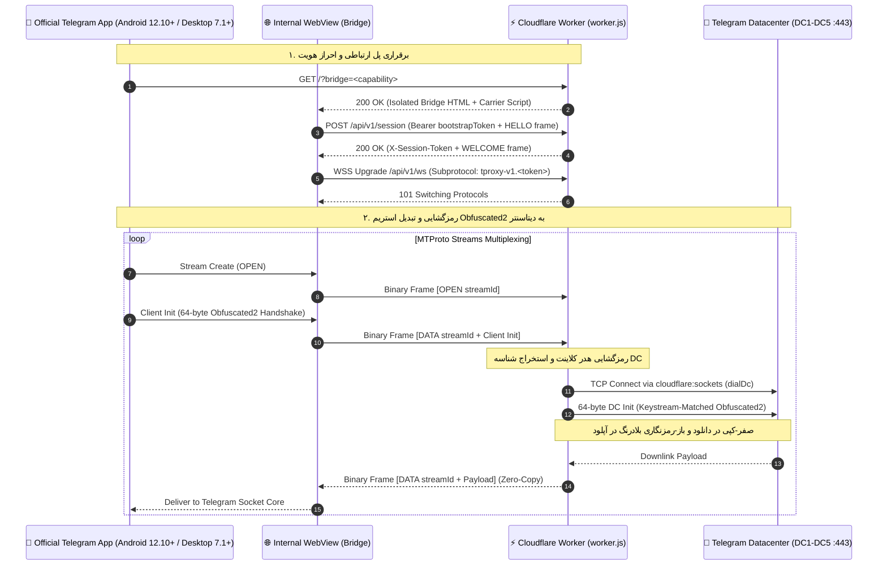

<div align="center">

# ⚡ TWP (Telegram Worker Proxy) Core v2.2

**Official Telegram WEB Proxy Engine for Cloudflare Workers (Zero VPS Required)**  
*موتور رسمی وب‌پروکسی تلگرام بر پایه ورکر کلادفلر — بدون نیاز به سرور VPS و تحویل مستقیم لینک اتصال*

[](LICENSE)
[-orange.svg)](https://workers.cloudflare.com)
[](docs/PROTOCOL.md)
[](docs/PROTOCOL.md)
[](https://t.me/qorvhexdeployer_bot)
[](https://t.me/Qorvhex_Channel)

[معرفی هسته (FA)](#-معرفی-هسته-twp-core-v22) • [نصب سریع با ربات](#روش-اول-استقرار-سریع-و-خودکار-با-ربات-تلگرام-پیشنهادی) • [English Documentation](#-english-documentation) • [معماری (Architecture)](#-معماری-پروتکل-architecture) • [نحوه دریافت لینک و اتصال](#-دریافت-لینک-و-اتصال-مستقیم) • [استقرار سرورلس](#-استقرار-هسته-سرور-server-deployment) • [مشخصات پروتکل](#-مشخصات-فنی-پروتکل-protocol-spec) • [جامعه کاربری](#-ارتباط-و-جامعه-کاربری-community--updates)

</div>

---

## 📖 معرفی هسته (TWP Core v2.2)

پروژه **TWP (Telegram Worker Proxy)** یک هسته سرورلس سبک، مستقل و ۱۰۰٪ متن‌باز برای استقرار پروتکل رسمی **Telegram WEB Proxy** بر بستر شبکه توزیع‌شده Cloudflare Workers است.

تلگرام به صورت رسمی نوع جدیدی از پروکسی تحت عنوان **WEB Proxy** را معرفی کرده است که اتصال کلاینت‌ها را به جای کانکشن‌های مستقیم و آسیب‌پذیر TCP، از طریق لایه استتاریافته حامل‌های وب (HTTPS و WebSocket) و یک وب‌ویوی خصوصی درون‌برنامه‌ای هدایت می‌کند. 

 مشخصات کامل پروژه رسمی تلگرام (`tproxy-server`) را بدون نیاز به سرور لینوکس، بدون نیاز به نصب Caddy و بدون نیاز به کامپایل سورس کلاینت، مستقیماً در قالب **تک‌فایل `worker.js`** در لبه پردازشی کلادفلر پیاده‌سازی کرده است و به کاربر **مستقیماً لینک وب‌پروکسی رسمی (`tg://webproxy`)** جهت اتصال با یک کلیک تحویل می‌دهد.

---

## 🚀 ویژگی‌های کلیدی (Key Highlights)

- **رابط کاربری مدرن Nothing OS:** داشبورد تعاملی با تم مشکی AMOLED، بافت ماتریسی (Dot-Matrix)، لهجه قرمز نمادین ناتینگ (`#D71921`) و ویجت‌های کپسولی Bento-box با پشتیبانی دو زبانه (FA/EN).
- **آزمون‌های خودکار جامع (Unit & E2E Testing):** مجهز به لودر شبیه‌ساز سوکت‌های کلودفلر و ۱۰ تست اتوماتیک با `npm test`.
- **بدون نیاز به سرور VPS (Zero VPS Cost):** اجرا به صورت ۱۰۰٪ سرورلس روی حساب رایگان Cloudflare Workers.
- **تولید مستقیم لینک اتصال:** تحویل لینک استاندارد `tg://webproxy?server=...&secret=...` و `https://t.me/webproxy` با داشبورد تعاملی و کد QR.
- **پشتیبانی نیتیو در کلاینت‌های تلگرام:** بدون نیاز به کامپایل کد اختصاصی یا کلاینت غیررسمی؛ تلگرام‌های رسمی مجهز به وب‌پروکسی مستقیماً به آن متصل می‌شوند.
- **ضد فیلترینگ و استتار کامل (DPI-Immune):** ترافیک در قالب HTTPS استاندارد روی پورت ۴۴۳ و وب‌سوکت معتبر به شبکه جهانی کلادفلر ارسال می‌شود.
- **مالتی‌پلکسینگ استاندارد فریم‌ها:** فریم‌های `OPEN`, `DATA`, `WINDOW`, `CLOSE` مستقیماً به سوکت‌های استریمینگ `cloudflare:sockets` تبدیل می‌شوند.
- **استتار در قالب سایت عادی (Camouflage Mode):** امکان تعریف دامنه فیک (`CAMOUFLAGE_URL`) تا اسکنرهای اینترنتی فاقد سکرت تنها یک سایت معمولی را مشاهده کنند.

---

## 🔗 دریافت لینک و اتصال مستقیم

پس از استقرار ورکر، با باز کردن آدرس ورکر خود در مرورگر (یا با فرمت استاندارد زیر)، لینک اتصال مستقیم تلگرام در اختیارتان قرار می‌گیرد:

```text
# لینک مستقیم جهت باز شدن آنی در اپلیکیشن تلگرام:
tg://webproxy?server=your-worker.your-subdomain.workers.dev&secret=000102030405060708090a0b0c0d0e0f

# لینک وب جهت اشتراک‌گذاری در چت‌ها:
https://t.me/webproxy?server=your-worker.your-subdomain.workers.dev&secret=000102030405060708090a0b0c0d0e0f
```

> **نکته:** در صورت فعال‌سازی `BASE_PATH` (مثلاً `my-secret-slug`) جهت استتار بیشتر، سکرت کلاینت با پیشوند `0x70` در قالب unpadded base64url کدگذاری می‌شود که داشبورد ورکر این مقدار را به صورت خودکار محاسبه و آماده کلیک تحویل می‌دهد.

---

## 🏗️ معماری پروتکل (Architecture)



---

## ☁️ استقرار هسته سرور (Server Deployment)

### روش اول: استقرار سریع و خودکار با ربات تلگرام (پیشنهادی)

ساده‌ترین و سریع‌ترین روش برای راه‌اندازی و استقرار خودکار TWP بدون نیاز به کامپیوتر یا دانش فنی، استفاده از ربات تلگرام دیپلویر است:


1️⃣ وارد ربات دیپلویر بشید: [@qorvhexdeployer_bot](https://t.me/qorvhexdeployer_bot)  
2️⃣ اول مطمئن شید که یه حساب کاربری توی سایت [dash.cloudflare.com](https://dash.cloudflare.com) دارید.  
3️⃣ روی دکمه «🔑 ورود به صفحه ساخت توکن» کلیک کنید.  
4️⃣ در صفحه‌ای که باز میشه فقط اسکرول کنید پایین و روی **Continue to summary** بزنید.  
5️⃣ در صفحه بعد روی **Create Token** بزنید.  
6️⃣ توکن نمایش داده شده رو کپی کنید و برای ربات ارسال کنید! ✨  
7️⃣ گزینه **نصب وب پروکسی تلگرام (TWP)** رو انتخاب کنید.

---

### روش دوم: استقرار از طریق پنل وب کلادفلر

1. وارد داشبورد [dash.cloudflare.com](https://dash.cloudflare.com) شوید.
2. از منوی **Workers & Pages** روی **Create Application** و سپس **Create Worker** کلیک کنید.
3. یک نام دلخواه انتخاب کرده و **Deploy** را بزنید.
4. وارد بخش **Edit code** شوید، کدهای پیش‌فرض را پاک کرده و کل محتوای فایل [`worker.js`](worker.js) را درون ادیتور پیست کنید.
5. دکمه **Save and Deploy** را بزنید.
6. لینک اتصال مستقیم شما آماده است:
   ```text
   tg://webproxy?server=your-worker-name.your-subdomain.workers.dev&secret=000102030405060708090a0b0c0d0e0f
   ```

### روش سوم: استقرار با خط فرمان Wrangler CLI

```bash
# ۱. کلون کردن ریپازیتوری
git clone https://github.com/Qorvhex/TWP.git
cd TWP

# ۲. ورود به حساب کلادفلر
npx wrangler login

# ۳. استقرار فوری
npx wrangler deploy
```

---

## ⚙️ متغیرهای محیطی (Environment Variables)

متغیرهای زیر در فایل [`wrangler.toml`](wrangler.toml) یا در پنل کلادفلر (**Settings** -> **Variables and Secrets**) قابل تنظیم هستند (تنظیم آن‌ها اختیاری است و در صورت خالی بودن از مقادیر پیش‌فرض استفاده می‌شود):

| متغیر | مقدار پیش‌فرض | توضیحات فنی |
| :--- | :--- | :--- |
| `PROXY_SECRET` یا `SECRET` | `000102030405060708090a0b0c0d0e0f` | کلید ۱۶ بایتی هگز (یا پیشوند `dd` + ۱۶ بایت برای رندوم پدینگ). |
| `MAX_DIALS` | `45` | سقف تعداد اتصال‌های مجاز سوکت دیتاسنتر به ازای هر نشست وب‌سوکت قبل از باز کردن Lane جدید. |

---

## 📜 مشخصات فنی پروتکل (Protocol Spec)

| بخش | مسیر در مخزن | شرح وظیفه |
| :--- | :--- | :--- |
| **Serverless Core Engine** | [`worker.js`](worker.js) | هسته تک‌فایلی کامل ورکر شامل پل کریپتوگرافیک، مدیریت نشست، وب‌سوکت کریر، و استریمینگ TCP |
| **Protocol Specification** | [`docs/PROTOCOL.md`](docs/PROTOCOL.md) | قرارداد دقیق فریم‌های باینری، هدرهای کنترلی، و فرمول‌های محاسباتی HMAC-SHA256 |
| **Architecture Specification** | [`docs/ARCHITECTURE.md`](docs/ARCHITECTURE.md) | بررسی مدل فنی، مزایای رقابتی در مقایسه با MTProxy و SOCKS5، و امنیت لایه انتقال |
| **Deployment Guide** | [`docs/DEPLOY_CLOUDFLARE.md`](docs/DEPLOY_CLOUDFLARE.md) | راهنمای گام‌به‌گام استقرار روی کلادفلر در کمتر از ۱ دقیقه |
| **Test Suite** | [`test/worker.test.mjs`](test/worker.test.mjs) | مجموعه آزمون‌های خودکار واحد و انتها-به-انتها با شبیه‌ساز سوکت |

---

## 🌐 English Documentation

### Overview
**TWP (Telegram Worker Proxy) Core v2.2** is an open-source, serverless implementation of the official **Telegram WEB Proxy** wire contract (`tproxy-server`) engineered entirely for Cloudflare Workers. 

Telegram's official WEB proxy routes MTProto traffic through an app-owned internal WebView carrier using standard HTTPS and WebSockets. **TWP v2.2** runs this entire relay architecture serverless within a single [`worker.js`](worker.js) script using `cloudflare:sockets` — eliminating the need for Linux VPS servers, Caddy configurations, or custom C++ client patching.

### Key Features
- **Zero VPS Cost:** 100% serverless, zero maintenance, fully compatible with Cloudflare's free plan.
- **Direct Telegram Link Delivery:** Generates and presents `tg://webproxy?server=...&secret=...` and `https://t.me/webproxy` with one-click connect and responsive QR codes.
- **Native Client Support:** Works out of the box with official Telegram clients that support WEB proxies (Telegram Desktop, Android, iOS).
- **Censorship & DPI Resistance:** Pure TLS 1.3 HTTPS and RFC 6455 WebSockets over standard Port 443 with Cloudflare Anycast CDN routing.
- **Binary Frame Multiplexing:** Full implementation of Telegram's 8-byte header frame multiplexer (`OPEN`, `DATA`, `WINDOW`, `CLOSE`, `PING`, `PONG`).

### ⚡ 1-Click Quick Deploy via Telegram Bot (Recommended)

The easiest and fastest way to deploy TWP in under 1 minute without needing any coding or server setup:

1️⃣ Open the deployer bot: [@qorvhexdeployer_bot](https://t.me/qorvhexdeployer_bot)  
2️⃣ Ensure you have an active account on [dash.cloudflare.com](https://dash.cloudflare.com).  
3️⃣ Click the button **«🔑 ورود به صفحه ساخت توکن»** (Open Token Creation Page).  
4️⃣ On the Cloudflare page that opens, simply scroll down and click **Continue to summary**.  
5️⃣ On the next page, click **Create Token**.  
6️⃣ Copy the displayed token and send it to the bot! ✨  
7️⃣ Select the **نصب وب پروکسی تلگرام (TWP)** (Install Telegram Web Proxy - TWP) option.

### Alternative Deploy (Wrangler CLI)
```bash
git clone https://github.com/Qorvhex/TWP.git
cd TWP
npx wrangler deploy
```

---

## 📢 ارتباط و جامعه کاربری (Community & Updates)

جهت دریافت آخرین اخبار، به‌روزرسانی‌های هسته TWP و آموزش‌های شبکه به کانال رسمی تلگرام بپیوندید:

<div align="center">

[](https://t.me/Qorvhex_Channel)

👉 **[کانال رسمی تلگرام: @Qorvhex_Channel](https://t.me/Qorvhex_Channel)** 👈

</div>

---


---

## 🧪 تست و توسعه محلی (Testing & Development)

پروژه TWP دارای سیستم آزمون‌های خودکار برای اعتبارسنجی توابع رمزنکاری، ساختار فریم‌ها و جریان ترافیک بدون نیاز به استقرار ابری است:

```bash
# ۱. اجرای آزمون‌های خودکار (10 تست E2E و Unit)
npm test

# ۲. اعتبارسنجی سینتکس و ساخت درای‌ران
npm run lint

# ۳. اجرای سرور توسعه محلی
npm run dev
```


## 📄 مجوز (License)

این هسته تحت مجوز **MIT License** منتشر شده است. استفاده و توسعه آن در پروژه‌های آزاد و تجاری آزاد است.
