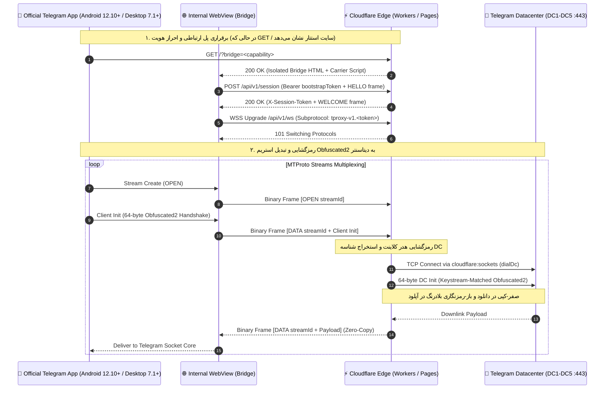

<div align="center">


# ⚡ TWP (Telegram Worker Proxy) Core v2.3

**موتور رسمی وب‌پروکسی تلگرام بر پایه Cloudflare Workers و Pages — بدون نیاز به سرور VPS و مجهز به حالت استتار خودکار**  
*[🇬🇧 Read in English (README.en.md)](README.en.md)*

[](LICENSE)
[](https://workers.cloudflare.com)
[](docs/PROTOCOL.md)
[](docs/PROTOCOL.md)
[](https://t.me/qorvhexdeployer_bot)
[](https://t.me/Qorvhex_Channel)

[معرفی هسته (v2.3)](#-معرفی-هسته-twp-core-v23) • [نصب سریع با ربات](#روش-اول-استقرار-سریع-و-خودکار-با-ربات-تلگرام-پیشنهادی) • [استقرار روی Pages](#روش-سوم-استقرار-روی-cloudflare-pages-با-آپلود-zip) • [متغیرهای محیطی](#%EF%B8%8F-متغیرهای-محیطی-environment-variables) • [معماری پروتکل](#%EF%B8%8F-معماری-پروتکل-architecture) • [English Docs](README.en.md)

</div>

---

## 📖 معرفی هسته (TWP Core v2.3)

پروژه **TWP (Telegram Worker Proxy)** یک هسته سرورلس سبک، مستقل و ۱۰۰٪ متن‌باز برای استقرار پروتکل رسمی **Telegram WEB Proxy** بر بستر شبکه توزیع‌شده **Cloudflare Workers** و **Cloudflare Pages** است.

تلگرام به صورت رسمی نوع جدیدی از پروکسی تحت عنوان **WEB Proxy** را معرفی کرده است که اتصال کلاینت‌ها را به جای کانکشن‌های مستقیم و آسیب‌پذیر TCP، از طریق لایه استتاریافته حامل‌های وب (HTTPS و WebSocket) و یک وب‌ویوی خصوصی درون‌برنامه‌ای هدایت می‌کند.

هسته TWP مشخصات کامل پروژه رسمی تلگرام (`tproxy-server`) را بدون نیاز به سرور لینوکس، بدون نیاز به نصب Caddy و بدون نیاز به کامپایل سورس کلاینت، مستقیماً در قالب **تک‌فایل [`worker.js`](worker.js)** (و بسته آماده [`Pages/twp-pages.zip`](Pages/twp-pages.zip) برای Pages) پیاده‌سازی کرده است و به کاربر **مستقیماً لینک وب‌پروکسی رسمی (`tg://webproxy`)** را جهت اتصال با یک کلیک تحویل می‌دهد.

---

## 🚀 ویژگی‌های کلیدی (Key Highlights)

- **مسیر مخفی مدیریت (`ADMIN`) + سایت استتار خودکار:** با تنظیم متغیر `ADMIN`، پنل مدیریت به آدرس `WORKERURL/ADMIN` منتقل می‌شود و در آدرس اصلی یک وب‌سایت انگلیسی سبک و مینیمال (بدون هیچ کد جاوااسکریپت یا ردپای پروکسی) نمایش داده می‌شود تا خزنده‌ها و سیستم‌های فیلترینگ نتوانند پروکسی بودن دامنه را تشخیص دهند.
- **هشدار امنیتی هوشمند در داشبورد:** اگر `ADMIN` ست نشده باشد یا `SECRET` همچنان مقدار پیش‌فرض باشد، یک کارت **هشدار امنیتی** بالای کارت کانال ظاهر می‌شود و با زدن دکمه **مشاهده**، وضعیت دقیق هر متغیر، خطرات احتمالی، آموزش تنظیم همراه با کلید رندوم ۳۲ کاراکتری قابل کپی و لینک ربات دیپلویر نمایش داده می‌شود.
- **پشتیبانی از Cloudflare Pages (Direct ZIP Upload):** علاوه بر Workers، فایل فشرده آماده [`Pages/twp-pages.zip`](Pages/twp-pages.zip) برای اجرا با آپلود مستقیم روی Cloudflare Pages ارائه شده است.
- **رابط کاربری مدرن Nothing OS:** داشبورد تعاملی با تم مشکی AMOLED، بافت ماتریسی (Dot-Matrix)، لهجه قرمز نمادین (`#D71921`) و ویجت‌های کپسولی Bento-box با پشتیبانی دو زبانه (FA/EN).
- **آزمون‌های خودکار جامع (Unit & E2E Testing):** مجهز به لودر شبیه‌ساز سوکت‌های کلودفلر و ۱۲ تست اتوماتیک با `npm test`.
- **بدون نیاز به سرور VPS (Zero VPS Cost):** اجرا به صورت ۱۰۰٪ سرورلس روی حساب رایگان Cloudflare Workers یا Pages.
- **تولید مستقیم لینک اتصال:** تحویل لینک استاندارد `tg://webproxy?server=...&secret=...` و `https://t.me/webproxy` با داشبورد تعاملی و کد QR.
- **پشتیبانی نیتیو در کلاینت‌های تلگرام:** بدون نیاز به کامپایل کد اختصاصی یا کلاینت غیررسمی؛ تلگرام‌های رسمی مجهز به وب‌پروکسی مستقیماً به آن متصل می‌شوند.
- **مالتی‌پلکسینگ استاندارد فریم‌ها:** فریم‌های `OPEN`, `DATA`, `WINDOW`, `CLOSE` مستقیماً به سوکت‌های استریمینگ `cloudflare:sockets` تبدیل می‌شوند.

---

## 🔗 دریافت لینک و اتصال مستقیم

پس از استقرار، اگر متغیر `ADMIN` تنظیم شده باشد با باز کردن `https://your-domain/YOUR_ADMIN` (و در غیر این صورت با باز کردن آدرس اصلی)، پنل مدیریت با لینک اتصال و کد QR در اختیارتان قرار می‌گیرد:

```text
# لینک مستقیم جهت باز شدن آنی در اپلیکیشن تلگرام:
tg://webproxy?server=your-worker.your-subdomain.workers.dev&secret=YOUR_32_CHAR_HEX_SECRET

# لینک وب جهت اشتراک‌گذاری در چت‌ها:
https://t.me/webproxy?server=your-worker.your-subdomain.workers.dev&secret=YOUR_32_CHAR_HEX_SECRET
```

> **توصیه مهم امنیتی:** پیش از اشتراک‌گذاری یا استفاده عمومی، حتماً هر دو متغیر `ADMIN` و `SECRET` را در تنظیمات ورکر/پیجز تغییر دهید تا آدرس اصلی فقط سایت عادی استتار را نشان دهد و کسی جز شما به پروکسی و پنل دسترسی نداشته باشد.

---

## 🏗️ معماری پروتکل (Architecture)



---

## ☁️ استقرار هسته سرور (Server Deployment)

### روش اول: استقرار سریع و خودکار با ربات تلگرام (پیشنهادی)

ساده‌ترین و سریع‌ترین روش برای راه‌اندازی و استقرار خودکار TWP (همراه با تنظیم خودکار متغیرهای امنیتی) بدون نیاز به کامپیوتر یا دانش فنی، استفاده از ربات تلگرام دیپلویر است:

1️⃣ وارد ربات دیپلویر بشید: [@qorvhexdeployer_bot](https://t.me/qorvhexdeployer_bot)  
2️⃣ اول مطمئن شید که یه حساب کاربری توی سایت [dash.cloudflare.com](https://dash.cloudflare.com) دارید.  
3️⃣ روی دکمه «🔑 ورود به صفحه ساخت توکن» کلیک کنید.  
4️⃣ در صفحه‌ای که باز میشه فقط اسکرول کنید پایین و روی **Continue to summary** بزنید.  
5️⃣ در صفحه بعد روی **Create Token** بزنید.  
6️⃣ توکن نمایش داده شده رو کپی کنید و برای ربات ارسال کنید! ✨  
7️⃣ گزینه **نصب وب پروکسی تلگرام (TWP)** رو انتخاب کنید.

---

### روش دوم: استقرار از طریق پنل وب Cloudflare Workers

1. وارد داشبورد [dash.cloudflare.com](https://dash.cloudflare.com) شوید.
2. از منوی **Workers & Pages** روی **Create Application** و سپس **Create Worker** کلیک کنید.
3. یک نام دلخواه انتخاب کرده و **Deploy** را بزنید.
4. وارد بخش **Edit code** شوید، کدهای پیش‌فرض را پاک کرده و کل محتوای فایل [`worker.js`](worker.js) را درون ادیتور پیست کنید و **Deploy** را بزنید.
5. از تب **Settings** -> **Variables and Secrets** دو متغیر `ADMIN` و `SECRET` را تنظیم و ذخیره کنید (یا ابتدا آدرس ورکر را باز کرده و از کارت **هشدار امنیتی** کلید رندوم پیشنهادی را کپی کنید).

---

### روش سوم: استقرار روی Cloudflare Pages با آپلود ZIP

اگر ترجیح می‌دهید پروژه را روی دامنه `pages.dev` بدون کپی‌کردن دستی کد اجرا کنید:

1. فایل آماده [`Pages/twp-pages.zip`](Pages/twp-pages.zip) را از مخزن دانلود کنید.
2. در داشبورد کلادفلر به **Workers & Pages** -> **Create** -> تب **Pages** -> گزینه **Upload assets** بروید.
3. یک نام دلخواه برای پروژه انتخاب کنید و فایل `twp-pages.zip` را آپلود و **Deploy site** را بزنید.
4. سپس از مسیر **Settings** -> **Variables and Secrets** متغیرهای `ADMIN` و `SECRET` را تنظیم کنید (پس از افزودن متغیرها، یک‌بار پروژه را مجدداً Deploy یا Retry deployment کنید تا اعمال شوند).

---

### روش چهارم: استقرار با خط فرمان Wrangler CLI

```bash
# ۱. کلون کردن ریپازیتوری
git clone https://github.com/Qorvhex/TWP.git
cd TWP

# ۲. ورود به حساب کلادفلر
npx wrangler login

# ۳. استقرار فوری
npx wrangler deploy
```

---

## ⚙️ متغیرهای محیطی (Environment Variables)

متغیرهای زیر در فایل [`wrangler.toml`](wrangler.toml) یا در پنل کلادفلر (**Settings** -> **Variables and Secrets**) قابل تنظیم هستند:

| متغیر | وضعیت / پیش‌فرض | توضیحات فنی و امنیتی |
| :--- | :--- | :--- |
| `ADMIN` | اختیاری (توصیه‌شده) / ندارد | مسیر مخفی پنل مدیریت (بدون فاصله، مثلاً `panel-8x9k`). هنگام تنظیم، پنل فقط در `WORKERURL/<ADMIN>` باز شده و روت (`/`) یک سایت عادی و سبک استتار نمایش می‌دهد. در صورت خالی بودن، پنل در `/` همراه با کارت **هشدار امنیتی** باز می‌شود. |
| `SECRET` (یا `PROXY_SECRET`) | `000102030405060708090a0b0c0d0e0f` | کلید ۱۶ بایتی هگز (۳۲ کاراکتر هگز، یا پیشوند `dd` + ۳۲ کاراکتر برای پدینگ تصادفی). در صورت باقی ماندن روی مقدار پیش‌فرض، کارت **هشدار امنیتی** به شما اطلاع می‌دهد. |
| `MAX_DIALS` | `45` | سقف تعداد اتصال‌های مجاز سوکت دیتاسنتر به ازای هر نشست وب‌سوکت قبل از باز کردن Lane جدید. |

---

## 📜 مشخصات فنی و فایل‌های مخزن (Specs & Files)

| بخش | مسیر در مخزن | شرح وظیفه |
| :--- | :--- | :--- |
| **Serverless Core Engine** | [`worker.js`](worker.js) | هسته تک‌فایلی کامل ورکر شامل پل کریپتوگرافیک، مدیریت نشست، وب‌سوکت کریر، سایت استتار و پنل مدیریت |
| **Cloudflare Pages Bundle** | [`Pages/twp-pages.zip`](Pages/twp-pages.zip) | بسته فشرده آماده آپلود مستقیم در Cloudflare Pages شامل `_worker.js`، `_routes.json`، `index.html` و `robots.txt` |
| **English Documentation** | [`README.en.md`](README.en.md) | مستندات کامل انگلیسی پروژه |
| **Protocol Specification** | [`docs/PROTOCOL.md`](docs/PROTOCOL.md) | قرارداد دقیق فریم‌های باینری، هدرهای کنترلی، و فرمول‌های محاسباتی HMAC-SHA256 |
| **Architecture Specification** | [`docs/ARCHITECTURE.md`](docs/ARCHITECTURE.md) | بررسی مدل فنی، مزایای رقابتی در مقایسه با MTProxy و SOCKS5، و امنیت لایه انتقال |
| **Deployment Guide** | [`docs/DEPLOY_CLOUDFLARE.md`](docs/DEPLOY_CLOUDFLARE.md) | راهنمای گام‌به‌گام استقرار روی Cloudflare Workers و Pages |
| **Test Suite** | [`test/worker.test.mjs`](test/worker.test.mjs) | مجموعه آزمون‌های خودکار واحد و انتها-به-انتها با شبیه‌ساز سوکت |

---

## 📢 ارتباط و جامعه کاربری (Community & Updates)

جهت دریافت آخرین اخبار، به‌روزرسانی‌های هسته TWP و آموزش‌های شبکه به کانال رسمی تلگرام بپیوندید:

<div align="center">

[](https://t.me/Qorvhex_Channel)

👉 **[کانال رسمی تلگرام: @Qorvhex_Channel](https://t.me/Qorvhex_Channel)** 👈

</div>

---

## 🧪 تست و توسعه محلی (Testing & Development)

پروژه TWP دارای سیستم آزمون‌های خودکار برای اعتبارسنجی توابع رمزنگاری، ساختار فریم‌ها، روتر `ADMIN`، هشدار امنیتی و جریان ترافیک بدون نیاز به استقرار ابری است:

```bash
# ۱. اجرای آزمون‌های خودکار (۱۲ تست E2E و Unit)
npm test

# ۲. اعتبارسنجی سینتکس و ساخت درای‌ران
npm run lint

# ۳. اجرای سرور توسعه محلی
npm run dev
```

---

## 📄 مجوز (License)

این هسته تحت مجوز **MIT License** منتشر شده است. استفاده و توسعه آن در پروژه‌های آزاد و تجاری آزاد است.
