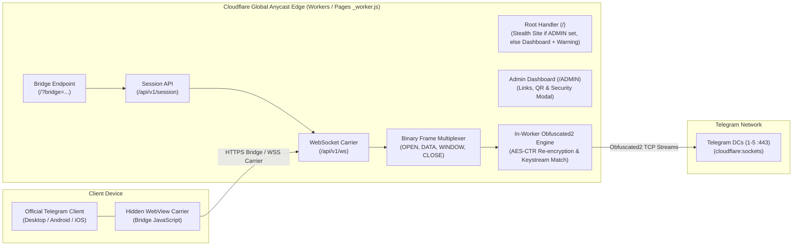

# TWP Technical Architecture (v2.3)

This document describes the internal engineering, data flow, and networking model of **TWP (Telegram Worker Proxy)** implementing the official Telegram WEB Proxy specification on **Cloudflare Workers** and **Cloudflare Pages**.

---

## 1. High-Level Overview



---

## 2. Key Architectural Advantages

| Feature | Standard MTProxy | VPS Relay (tproxy-server) | **TWP (Cloudflare Workers / Pages)** |
| :--- | :--- | :--- | :--- |
| **Server Requirements** | Linux VPS ($5+/month) | Linux VPS + Caddy | **100% Serverless (Workers & Pages Free Tier)** |
| **Setup Complexity** | Complex (Compiling C, systemd) | High (Caddy, Go daemon, firewall) | **Instant (Bot, `worker.js`, or Pages ZIP)** |
| **DPI & Crawler Stealth** | High detection risk | Static/proxy camouflage | **Built-in Minimal Website at `/` when `ADMIN` is set** |
| **Client Support** | Standard MTProxy | Official Telegram WEB Proxy | **Official Telegram WEB Proxy (`tg://webproxy`)** |
| **Global Edge Latency** | Single Datacenter | Single Datacenter | **Anycast across 300+ Cities Worldwide** |
| **Direct Link Delivery** | Manual configuration | Manual configuration | **Built-in Web Dashboard with Security Audit & QR** |

---

## 3. Communication Lifecycle

### Step 1: Stealth vs. Admin Isolation
1. When `ADMIN` is configured, `GET /` and `HEAD /` serve a lightweight, self-contained HTML editorial page with zero JavaScript and zero proxy indicators.
2. Opening `GET /<ADMIN>` serves the management dashboard (`noindex, nofollow`). If `SECRET` is still on its default value (`000102030405060708090a0b0c0d0e0f`) or `ADMIN` is unset, a Security Warning card and interactive modal prompt the operator with risks and one-click random secret generation.

### Step 2: Bridge Handshake
1. The user taps a `tg://webproxy?server=<host>&secret=<secret>` link.
2. The Telegram client verifies the secret and launches an internal WebView to:
   ```text
   GET /?bridge=<capability>#android=<nonce>
   ```
3. `worker.js` calculates `HMAC-SHA256` capability. Upon validation, it renders the official Bridge HTML document with cryptographic nonces and strict CSP headers.

### Step 3: Session & Carrier Establishment
1. The WebView executes the isolated bridge script, issues `POST /api/v1/session` with a `HELLO` frame (`0x10`), and receives a `WELCOME` frame (`0x11`) and a signed `sessionToken`.
2. The bridge initiates a WebSocket connection to `/api/v1/ws` with `Sec-WebSocket-Protocol: tproxy-v1.<sessionToken>`.

### Step 4: Multiplexed TCP Streaming via `cloudflare:sockets`
1. For every MTProto stream, the client issues an `OPEN` frame (`0x01`).
2. `worker.js` calls `connect({ hostname, port })` using `cloudflare:sockets` to establish an outbound TCP socket to the Telegram datacenter.
3. `DATA` frames (`0x02`) are piped directly to the TCP socket writer.
4. Incoming TCP data is read and wrapped in `DATA` binary frames sent over WebSocket back to the client.
