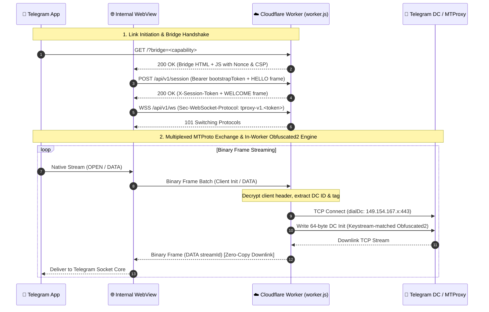

# Telegram WEB Proxy Protocol Specification (v1)

This document describes the wire contract implemented by **TWP (Telegram Worker Proxy)**, matching the official Telegram WEB Proxy specification (`tproxy-server`).

---

## 1. Overview & Architecture

The Telegram WEB Proxy enables official Telegram clients (Desktop, Android, iOS) to route MTProto connections through an app-owned internal WebView carrier without requiring customized client builds or vulnerable direct TCP connections.



---

## 2. Link Formats

Telegram recognizes two URI schemes for WEB proxies:
- **Deep Link (Direct Action):** `tg://webproxy?server=<hostname>&secret=<secret>`
- **Web Link (Shareable):** `https://t.me/webproxy?server=<hostname>&secret=<secret>`

### Parameters:
- `server`: Canonical lowercase IDNA hostname (e.g. `twp.example.workers.dev`). If a Base Path is used, it is percent-encoded: `server=example.com%2Fslug`.
- `secret`: Plain 16-byte hex secret (e.g. `000102030405060708090a0b0c0d0e0f`). When used with a Base Path, the secret is marked with `0x70` and encoded in unpadded base64url.

---

## 3. Cryptographic Bridge Capability

When the link is opened, the Telegram client loads the bridge URL into its hidden WebView:

```text
URL = https://<hostname>/?bridge=<capability>#android=<webview-nonce>
```

### Derivation:
- **Root Deployment:**
  ```text
  context = UTF-8("tdesktop-web-proxy-bridge-v1\n" + hostname)
  bridge  = base64url-no-padding(HMAC-SHA256(key=secretBytes, message=context))
  ```
- **Base Path Deployment (`BASE_PATH = slug`):**
  ```text
  context = UTF-8("tdesktop-web-proxy-bridge-v2\n" + hostname + "\n" + slug)
  bridge  = base64url-no-padding(HMAC-SHA256(key=secretBytes, message=context))
  ```

---

## 4. Session Handshake & Carrier

1. **Bootstrap Token:** Issued by `worker.js` upon valid bridge request.
2. **Session Creation (`POST /api/v1/session`):**
   - Header: `Authorization: Bearer <bootstrapToken>`
   - Body: `HELLO` Frame (Type `0x10`, StreamID `0`, Payload `[0x01]`)
   - Response: `WELCOME` Frame (Type `0x11`, StreamID `0`, Payload `[0x01]`), Header `X-Session-Token`
3. **Carrier Connection (`GET /api/v1/ws`):**
   - Header: `Sec-WebSocket-Protocol: tproxy-v1.<sessionToken>`
   - Upgraded to Full-Duplex Binary WebSocket.

---

## 5. Binary Frame Format

All messages exchanged over the carrier are 8-byte header binary frames:

```text
+---------------+-------------------+-----------------------+---------------------+
| Type (1 Byte) | StreamID (3 Bytes)| Length (4 Bytes uint) | Payload (0..N Bytes)|
+---------------+-------------------+-----------------------+---------------------+
|   Byte 0      |     Bytes 1-3     |       Bytes 4-7       |     Bytes 8...      |
+---------------+-------------------+-----------------------+---------------------+
```

### Frame Types:
| Type | Name | Purpose |
| :--- | :--- | :--- |
| `0x01` | `OPEN` | Requests opening a new TCP connection for `StreamID`. |
| `0x02` | `DATA` | Carries MTProto payload bytes for `StreamID`. |
| `0x03` | `CLOSE` | Notifies that `StreamID` has closed. |
| `0x04` | `WINDOW` | Flow control window credit update. |
| `0x05` | `PING` | Carrier keepalive check. |
| `0x06` | `PONG` | Carrier keepalive response. |
| `0x10` | `HELLO` | Initial session creation frame. |
| `0x11` | `WELCOME` | Server session acknowledgment. |
| `0x1F` | `BYE` | Session termination. |
